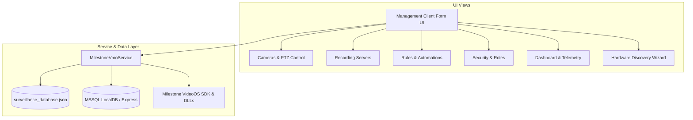

# 📹 LycheeVMS — Milestone XProtect Management Client (.NET)


> **LycheeVMS / Milestone XProtect Management Client** ek enterprise-grade Video Management System (VMS) administration suite hai, jo surveillance cameras, recording servers, storage retention, security rules, access control, aur AI analytics ko centrally manage karne ke liye design kiya gaya hai.

---

## 📑 Table of Contents

- [Overview](#-overview)
- [Key Features](#-key-features)
- [System Architecture](#-system-architecture)
- [Project Directory Structure](#-project-directory-structure)
- [Prerequisites](#-prerequisites)
- [How to Build & Run](#-how-to-build--run)
- [Modules & Views Overview](#-modules--views-overview)
- [Database & Persistence](#-database--persistence)
- [Troubleshooting & Logs](#-troubleshooting--logs)

---

## 🌟 Overview

Yeh application **Milestone XProtect VMS 2025** platform ke sath seamlessly integrate hoti hai. Isme modern desktop UI (Windows Forms with modern aesthetic styling) aur backend services ka use kiya gaya hai jo **VideoOS Core Platform APIs** aur **MSSQL Database** ke sath interact karte hain.

### Key Highlights:
- **Zero Configuration Setup:** `build.bat` aur `run.bat` scripts ke through direct single-click build & launch.
- **Hardware Auto-Discovery:** ONVIF aur generic cameras ke liye step-by-step wizard.
- **Dual Persistence Layer:** Local state caching (`surveillance_database.json`) aur Enterprise MSSQL (`(localdb)\MSSQLLocalDB`) sync.
- **Robust Exception Handling:** Application level thread monitoring aur auto-logging (`startup.log`).

---

## 🚀 Key Features

| Feature | Description |
| :--- | :--- |
| **🎥 Camera Management** | Real-time live feeds, PTZ navigation, H.264/H.265/MJPEG stream settings, FPS, bitrates, motion detection, aur privacy masking. |
| **🖥️ Recording Servers** | Server health monitoring (CPU, RAM, Disk I/O), failover redundancy, service clustering, aur recording paths. |
| **🧙 Add Hardware Wizard** | Multi-step discovery wizard for ONVIF, RTSP, and IP camera credentials negotiation. |
| **⚡ Rules Engine** | Automated actions based on triggers (Motion Detection, Schedule, PTZ preset, Alarm input). |
| **🔐 Security & Access Control** | Windows Active Directory & Basic Auth support, RBAC user role permissions matrix. |
| **📊 System Dashboard** | Live telemetry, bandwidth consumption, storage utilization, active camera counters. |
| **🚨 Alarms & Incident Management** | Real-time alarm monitoring, priority queues, operator acknowledgment workflows. |
| **🧠 AI Video Analytics** | Perimeter protection, License Plate Recognition (LPR), Facial Recognition, Object Classification. |
| **📜 License Manager** | License entitlement tracking (`.lic` import), device pack allocations, MAC address binding. |

---

## 🏛️ System Architecture



---

## 📂 Project Directory Structure

```text
Milestone_ManagementClient_Net/
├── bin/                              # Output compiled executable and native dependencies
├── Core/                             # Core Domain Engines & Hardware Registries
│   ├── AccessControl/                # Physical Access Control (PACS), doors & badges
│   ├── MediaProcessing/              # Video frame scaling & GPU bicubic enhancements
│   ├── IncidentManager/              # Case management, digital evidence locks & audit
│   ├── SmartMap/                     # Interactive GIS map, layers, camera FOV cones
│   ├── Security/                     # X.509 CertificateManager & PKI bindings
│   ├── Failover/                     # Hot standby recording server cluster manager
│   ├── SCH/                          # System Configuration Host background health diagnostics
│   ├── HardwareDriverRegistry.cs     # Central catalog of 24+ camera brands & drivers
│   └── NetworkDiscoveryEngine.cs     # Network probes & multi-brand hardware scanner
├── Models/                           # Business Domain Models
│   ├── AccessControlModel.cs         # Doors, cardholders, reader events
│   ├── IncidentModel.cs              # Case files, evidence locks, bookmarks
│   ├── SmartMapModel.cs              # GIS layers, GPS coordinates, pin icons
│   ├── CertificateModel.cs           # TLS/SSL certificates, thumbprints, bindings
│   ├── CameraModel.cs                # Camera & stream properties, manufacturer metadata
│   ├── RecordingServerModel.cs       # Server specs & health metrics
│   ├── RuleModel.cs                  # Automation rules & triggers
│   ├── TaskModel.cs                  # Background operational tasks
│   └── UserModel.cs                  # User accounts & RBAC roles
├── Services/                         # Core Backend Services
│   ├── MilestoneVmoService.cs        # Primary business logic & controller
│   ├── SqlDatabaseService.cs         # MSSQL synchronization service
│   └── BackupRestoreService.cs       # Configuration backup & database restore
├── UI/                               # Modular Presentation Layer
│   ├── Forms/                        # Main Application Windows
│   │   └── ManagementClientForm.cs   # Main shell container & navigation tree
│   ├── Dialogs/                      # Modal Dialogs & Wizards
│   │   ├── LoginDialog.cs            # Authentication & server connection modal
│   │   ├── AddHardwareWizardDialog.cs# 24+ Brand camera discovery wizard
│   │   ├── CertificateConfiguratorDialog.cs # Server Configurator SSL/TLS wizard
│   │   └── BackupRestoreDialog.cs    # VMS configuration backup/restore wizard
│   └── Views/                        # Modular Workspace UserControls
│       ├── CamerasViewControl.cs     # Camera streaming & device settings
│       ├── ServersViewControl.cs     # Recording server topology
│       ├── FailoverClusterViewControl.cs # Failover secondary standby nodes
│       ├── SmartMapViewControl.cs    # Interactive GIS Smart Map & FOVs
│       ├── AccessControlViewControl.cs # PACS doors, readers & badges
│       ├── IncidentManagerViewControl.cs # Incident cases & evidence locks
│       ├── DashboardViewControl.cs   # System metrics overview
│       ├── RulesViewControl.cs       # Automation rule definitions
│       ├── SecurityViewControl.cs    # Users, groups & permissions
│       ├── LicenseViewControl.cs     # License status & activation
│       ├── AlarmsViewControl.cs      # Incident & alarm response
│       ├── AnalyticsViewControl.cs   # AI / LPR / Smart search
│       ├── MobileViewControl.cs      # Mobile Server & WebRTC gateway
│       ├── LogsViewControl.cs        # Audit trails & diagnostic logs
│       └── SiteViewControl.cs        # Multi-site interconnected hierarchy
├── MODULE_IMPLEMENTATION_WORKLIST.md # Master 210 Core Modules Implementation Checklist
├── Milestone_Core_Binaries/          # Milestone / VideoOS SDK libraries (Toolkit, Crypto, etc.)
├── Milestone_Core_Source/            # 210 Milestone reference source components
├── Program.cs                        # Application Entry Point & Global Exception Handlers
├── Milestone_ManagementClient.csproj # .NET SDK Project File (Wildcard modular includes)
├── build.bat                         # Automated x64 Compilation script
├── run.bat                           # Run script (Builds if needed, then executes)
├── create_shortcut.ps1               # Desktop shortcut generator
├── app.ico / Lychee.ico              # Application branding icons
└── cctv_frame.png                    # CCTV placeholder asset
```

---

## ⚙️ Prerequisites

1. **Operating System:** Windows 10, Windows 11, ya Windows Server (64-bit).
2. **.NET Runtime / SDK:**
   - .NET 8.0 Desktop Runtime (x64) **OR**
   - .NET Framework 4.0/4.8 (Included with Windows by default).
3. **Database (Optional for SQL sync):**
   - Microsoft SQL Server LocalDB (`(localdb)\MSSQLLocalDB`) ya SQL Server Express.

---

## 🔨 How to Build & Run

### Method 1: Using `run.bat` (Recommended)
Sabse simple tarika hai:
```cmd
run.bat
```
*Yeh script check karegi agar binary exist karti hai; nahi hone par automatically build karke application launch kar degi.*

---

### Method 2: Manual Build with `build.bat`
Native C# compiler (`csc.exe`) se compile karne ke liye:
```cmd
build.bat
```
Build complete hone ke baad executable yahan create hoga:
`bin\MilestoneXProtect-ManagementClient.exe`

---

### Method 3: Using .NET CLI
Agar aap .NET 8.0 SDK use kar rahe hain:
```cmd
dotnet build Milestone_ManagementClient.csproj -c Release
```

---

### Method 4: Desktop Shortcut Create Karna
Desktop par application ka shortcut banane ke liye PowerShell script run karein:
```powershell
powershell -ExecutionPolicy Bypass -File .\create_shortcut.ps1
```

---

## 🖥️ Modules & Views Overview

### 1. Cameras View (`CamerasViewControl.cs`)
- **Device Tree:** Camera hierarchy, enabled/disabled status, recording indicators.
- **Video Settings:** Resolution, Framerate (FPS), Bitrate (Kbps), Codec (H.264 / H.265 / MJPEG).
- **PTZ & Presets:** Pan, Tilt, Zoom navigation and preset point triggers.
- **Storage Configuration:** Retention period (Days), recording paths, frame rate limits.

### 2. Hardware Discovery Wizard (`AddHardwareWizardDialog.cs`)
- Step 1: Scan Type selection (Express Auto-detection vs Manual IP Range).
- Step 2: Device Credentials (Username / Password).
- Step 3: Hardware detection & channel selection.
- Step 4: Final verification & group assignment.

### 3. Rules & Automation (`RulesViewControl.cs`)
- Event triggers define karein jaise `On Motion Started`, `On Alarm Triggered`, `On Schedule Time`.
- Actions configure karein jaise `Start Recording on Cam 01`, `Move PTZ to Preset 1`, `Send Email Notification`.

### 4. Security & Users (`SecurityViewControl.cs`)
- RBAC support: Administrator, Operator, Viewer roles.
- Granular permissions: Live view access, Playback access, Export permissions, PTZ control rights.

---

## 💾 Database & Persistence

Application dual-layer persistence support karti hai:

1. **Local Database (`surveillance_database.json`):**
   - Client configurations, camera states, rules, users, aur audit logs automatically JSON file me store hote hain.
2. **MSSQL LocalDB / Enterprise Sync (`SqlDatabaseService.cs`):**
   - Connection String: `Server=(localdb)\MSSQLLocalDB;Database=Surveillance;Integrated Security=True;TrustServerCertificate=True`
   - Cameras ko `dbo.Devices` aur `dbo.Hardware` tables me sync karta hai.

---

## 🛠️ Troubleshooting & Logs

- **Startup Errors:** Application launch par koi issue aaye toh `startup.log` file check karein (application root directory me generate hoti hai).
- **Compilation Lock:** Agar process background me chal raha hai aur build fail ho, `Task Manager` se `MilestoneXProtect-ManagementClient.exe` ko end task karein aur dubara `build.bat` run karein.
- **Icon / Visual Assets:** `Lychee.ico` aur `cctv_frame.png` output `bin\` directory me automatic copy ho jaate hain.

---

## 📄 License & Proprietary Notice

Developed for **Milestone XProtect / LycheeVMS Ecosystem**. All Milestone SDK components and DLLs belong to their respective copyright holders.
