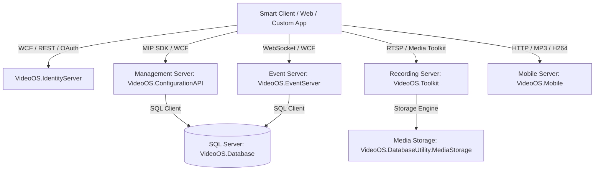

# 🍒 LycheeVMS 2025 R3 — Architecture, Module Catalog & API Reference

> **Platform:** LycheeVMS Intelligent Enterprise Suite (2025 Edition)  
> **Source Recovery:** 211 Decompiled .NET Projects in `./src/` | 16,584 C# Source Files  
> **Aesthetics & Theme:** Lychee Crimson Red (`#E11D48`), Deep Wine (`#9F1239`) & Soft Pulp Pink (`#FFE4E6`)  
> **Management Client:** Standalone Interactive GUI deployed in `Desktop/LycheeVMS/`  

---

## 🏗️ Folder-Wise Architecture (`./src/`)

All recovered projects are organized **folder-wise** into their native domain subsystems under [`./src/`](file:///c:/Program%20Files%20%28x86%29/i-Comply/Milestone/Milestone%20XProtect%20VMS%20Products%202025%20R3%20System%20Installer/src). Each project contains nested subfolders corresponding to its exact C# namespaces.

| Domain Directory | Projects | Description |
|---|---|---|
| [`src/Platform/`](file:///c:/Program%20Files%20%28x86%29/i-Comply/Milestone/Milestone%20XProtect%20VMS%20Products%202025%20R3%20System%20Installer/src/Platform) | 15 | Core MIP SDK, Live Streaming, Media Processing, Hardware Acceleration |
| [`src/Management/`](file:///c:/Program%20Files%20%28x86%29/i-Comply/Milestone/Milestone%20XProtect%20VMS%20Products%202025%20R3%20System%20Installer/src/Management) | 6 | Configuration API WCF services, VMO client, Management Server |
| [`src/EventServer/`](file:///c:/Program%20Files%20%28x86%29/i-Comply/Milestone/Milestone%20XProtect%20VMS%20Products%202025%20R3%20System%20Installer/src/EventServer) | 7 | Event Server Communication, WebSocket APIs, Service Hosts |
| [`src/Database/`](file:///c:/Program%20Files%20%28x86%29/i-Comply/Milestone/Milestone%20XProtect%20VMS%20Products%202025%20R3%20System%20Installer/src/Database) | 5 | SQL Database Layer, Media Storage, DB utility scripts |
| [`src/Identity/`](file:///c:/Program%20Files%20%28x86%29/i-Comply/Milestone/Milestone%20XProtect%20VMS%20Products%202025%20R3%20System%20Installer/src/Identity) | 18 | Identity Server, OAuth 2.0 / OpenID Connect, Certificate Config |
| [`src/Mobile/`](file:///c:/Program%20Files%20%28x86%29/i-Comply/Milestone/Milestone%20XProtect%20VMS%20Products%202025%20R3%20System%20Installer/src/Mobile) | 12 | Mobile Server, MP4 Muxer, WebRTC bridge, Portable SDK |
| [`src/IncidentManager/`](file:///c:/Program%20Files%20%28x86%29/i-Comply/Milestone/Milestone%20XProtect%20VMS%20Products%202025%20R3%20System%20Installer/src/IncidentManager) | 13 | Incident Manager WebAPI, Entity Framework repositories |
| [`src/LPR/`](file:///c:/Program%20Files%20%28x86%29/i-Comply/Milestone/Milestone%20XProtect%20VMS%20Products%202025%20R3%20System%20Installer/src/LPR) | 3 | License Plate Recognition logging and matching |
| [`src/RulesEngine/`](file:///c:/Program%20Files%20%28x86%29/i-Comply/Milestone/Milestone%20XProtect%20VMS%20Products%202025%20R3%20System%20Installer/src/RulesEngine) | 3 | Automation Rules Engine & Adapters |
| [`src/Reporting/`](file:///c:/Program%20Files%20%28x86%29/i-Comply/Milestone/Milestone%20XProtect%20VMS%20Products%202025%20R3%20System%20Installer/src/Reporting) | 2 | Reporting Web APIs and plugins |
| [`src/ServerCore/`](file:///c:/Program%20Files%20%28x86%29/i-Comply/Milestone/Milestone%20XProtect%20VMS%20Products%202025%20R3%20System%20Installer/src/ServerCore) | 8 | Core Server Services, Tray Controller, Backup & Failover |
| [`src/SCH/`](file:///c:/Program%20Files%20%28x86%29/i-Comply/Milestone/Milestone%20XProtect%20VMS%20Products%202025%20R3%20System%20Installer/src/SCH) | 8 | Service Configuration Host & Data Access layers |
| [`src/UI/`](file:///c:/Program%20Files%20%28x86%29/i-Comply/Milestone/Milestone%20XProtect%20VMS%20Products%202025%20R3%20System%20Installer/src/UI) | 6 | Shared WPF controls, UI styles, item pickers |
| [`src/Installer/`](file:///c:/Program%20Files%20%28x86%29/i-Comply/Milestone/Milestone%20XProtect%20VMS%20Products%202025%20R3%20System%20Installer/src/Installer) | 57 | Setup UI, Bootstrapper, Role plugins (Recording, Management, etc.) |
| [`src/Common/`](file:///c:/Program%20Files%20%28x86%29/i-Comply/Milestone/Milestone%20XProtect%20VMS%20Products%202025%20R3%20System%20Installer/src/Common) | 48 | Shared utilities, cryptography, websockets, telemetry |

---

## Table of Contents
1. [Subsystem Architecture Overview](#1-subsystem-architecture-overview)
2. [Module Breakdown & Project Directory Index](#2-module-breakdown--project-directory-index)
3. [Configuration API (IConfigurationService) Reference](#3-configuration-api-iconfigurationservice-reference)
4. [MIP SDK Core (VideoOS.Platform & SDK) Reference](#4-mip-sdk-core-videoosplatform--sdk-reference)
5. [Event Server & Alarm API (IAlarmCommand)](#5-event-server--alarm-api-ialarmcommand)
6. [Mobile Server API & Audio/Video Streaming](#6-mobile-server-api--audiovideo-streaming)
7. [Database Layer & Data Access Models](#7-database-layer--data-access-models)
8. [Installer Subsystem & Bootstrapper Mechanics](#8-installer-subsystem--bootstrapper-mechanics)
9. [Service Endpoint & Port Matrix](#9-service-endpoint--port-matrix)
10. [End-to-End C# Integration Examples](#10-end-to-end-c-integration-examples)

---

## 1. Subsystem Architecture Overview

Milestone XProtect VMS is a distributed video management architecture comprising multiple cooperating services connected via WCF, REST, and WebSockets.



---

## 2. Module Breakdown & Project Directory Index

All decompiled projects are organized in [`./Decompiled_Source`](file:///c:/Program%20Files%20%28x86%29/i-Comply/Milestone/Milestone%20XProtect%20VMS%20Products%202025%20R3%20System%20Installer/Decompiled_Source):

### A. Core Platform & SDK Layer
| Project Name | Path | Description |
|---|---|---|
| `VideoOS.Platform` | [`Decompiled_Source/VideoOS.Platform`](file:///c:/Program%20Files%20%28x86%29/i-Comply/Milestone/Milestone%20XProtect%20VMS%20Products%202025%20R3%20System%20Installer/Decompiled_Source/VideoOS.Platform) | MIP SDK core platform, environment init, message brokers |
| `VideoOS.Platform.SDK` | [`Decompiled_Source/VideoOS.Platform.SDK`](file:///c:/Program%20Files%20%28x86%29/i-Comply/Milestone/Milestone%20XProtect%20VMS%20Products%202025%20R3%20System%20Installer/Decompiled_Source/VideoOS.Platform.SDK) | High-level client SDK for camera playback, exports, bookmarks |
| `VideoOS.Platform.Primitives` | [`Decompiled_Source/VideoOS.Platform.Primitives`](file:///c:/Program%20Files%20%28x86%29/i-Comply/Milestone/Milestone%20XProtect%20VMS%20Products%202025%20R3%20System%20Installer/Decompiled_Source/VideoOS.Platform.Primitives) | Serialized structures, GUIDs, and coordinate primitives |
| `VideoOS.Toolkit` | [`Decompiled_Source/VideoOS.Toolkit`](file:///c:/Program%20Files%20%28x86%29/i-Comply/Milestone/Milestone%20XProtect%20VMS%20Products%202025%20R3%20System%20Installer/Decompiled_Source/VideoOS.Toolkit) | Video decoders, hardware acceleration (Intel QuickSync/Nvidia), Jitter buffers |

### B. Configuration & Management Layer
| Project Name | Path | Description |
|---|---|---|
| `VideoOS.ConfigurationAPI` | [`Decompiled_Source/VideoOS.ConfigurationAPI`](file:///c:/Program%20Files%20%28x86%29/i-Comply/Milestone/Milestone%20XProtect%20VMS%20Products%202025%20R3%20System%20Installer/Decompiled_Source/VideoOS.ConfigurationAPI) | Strongly-typed WCF configuration service for NVRs, cameras, and roles |
| `VideoOS.Management.VmoClient` | [`Decompiled_Source/VideoOS.Management.VmoClient`](file:///c:/Program%20Files%20%28x86%29/i-Comply/Milestone/Milestone%20XProtect%20VMS%20Products%202025%20R3%20System%20Installer/Decompiled_Source/VideoOS.Management.VmoClient) | VMO client proxies for Management Server communication |
| `VideoOS.Management.Common` | [`Decompiled_Source/VideoOS.Management.Common`](file:///c:/Program%20Files%20%28x86%29/i-Comply/Milestone/Milestone%20XProtect%20VMS%20Products%202025%20R3%20System%20Installer/Decompiled_Source/VideoOS.Management.Common) | Shared management models, security descriptors, and rights |

### C. Event Server & Alarms
| Project Name | Path | Description |
|---|---|---|
| `VideoOS.EventServer.Communication` | [`Decompiled_Source/VideoOS.EventServer.Communication`](file:///c:/Program%20Files%20%28x86%29/i-Comply/Milestone/Milestone%20XProtect%20VMS%20Products%202025%20R3%20System%20Installer/Decompiled_Source/VideoOS.EventServer.Communication) | Real-time event bus, alarm commands, and state subscriptions |
| `VideoOS.ServiceHost.EventServer` | [`Decompiled_Source/VideoOS.ServiceHost.EventServer`](file:///c:/Program%20Files%20%28x86%29/i-Comply/Milestone/Milestone%20XProtect%20VMS%20Products%202025%20R3%20System%20Installer/Decompiled_Source/VideoOS.ServiceHost.EventServer) | Windows service host wrapper for the Milestone Event Server |

### D. Database & Storage Architecture
| Project Name | Path | Description |
|---|---|---|
| `VideoOS.Database` | [`Decompiled_Source/VideoOS.Database`](file:///c:/Program%20Files%20%28x86%29/i-Comply/Milestone/Milestone%20XProtect%20VMS%20Products%202025%20R3%20System%20Installer/Decompiled_Source/VideoOS.Database) | SQL Server database provider, entity models, and CRUD operations |
| `VideoOS.DatabaseUtility.MediaStorage` | [`Decompiled_Source/VideoOS.DatabaseUtility.MediaStorage`](file:///c:/Program%20Files%20%28x86%29/i-Comply/Milestone/Milestone%20XProtect%20VMS%20Products%202025%20R3%20System%20Installer/Decompiled_Source/VideoOS.DatabaseUtility.MediaStorage) | Video archiving, disk retention, and storage path allocation |

---

## 3. Configuration API (`IConfigurationService`) Reference

Namespace: `VideoOS.ConfigurationAPI`  
Service Contract: `[ServiceContract(Namespace = "http://VideoOS.Net/ConfigurationService")]`  
Class: `ConfigurationServiceClient`

### Core API Methods

```csharp
public interface IConfigurationService
{
    // 1. Single Item Operations
    ConfigurationItem GetItem(string path);
    ValidateResult SetItem(ConfigurationItem item);
    ValidateResult ValidateItem(ConfigurationItem item);
    void DeleteItem(string path);

    // 2. Query & Hierarchy Operations
    ConfigurationItem[] GetItems(string itemType);
    bool HasChildItems(string path);
    ConfigurationItem[] GetChildItems(string path);
    ConfigurationItem[] GetChildItemsHierarchy(string path, string[] itemTypes, ItemFilter[] itemFilters);
    ConfigurationItem[] QueryItems(ItemFilter itemFilter, int maxResult);
    ConfigurationItem[] GetDependantItems(string path);

    // 3. Construction & Dynamic Factory
    ConfigurationItem ConstructItem(string itemType, Property[] properties);
    ConfigurationItem ConstructChildItem(string itemType, string parentPath);

    // 4. Invocation & Methods
    MethodInfo[] GetMethodInfos();
    MethodInfo GetMethodInfo(string methodId);
    ConfigurationItem InvokeMethod(ConfigurationItem item, string method);

    // 5. Localization
    Dictionary<string, string> GetTranslations(string languageId);
}
```

### Key Data Contracts
- `ConfigurationItem`:
  - `string Path`: Unique hierarchical identifier (e.g., `Hardware[guid]/Camera[guid]`)
  - `string ItemType`: `Hardware`, `Camera`, `Microphone`, `Speaker`, `InputEvent`, `Output`, `Storage`, `Role`
  - `string DisplayName`: Human-readable name
  - `Property[] Properties`: Key-value pair collection containing device settings (IP, Port, Username, Password, Codec, FPS, Resolution)
  - `ConfigurationItem[] Children`: Child devices / channels

### C# API Usage Example
```csharp
using System;
using System.ServiceModel;
using VideoOS.ConfigurationAPI;

var binding = new BasicHttpBinding(BasicHttpSecurityMode.TransportCredentialOnly);
binding.Security.Transport.ClientCredentialType = HttpClientCredentialType.Windows;
var endpoint = new EndpointAddress("http://<ServerIP>/ManagementServer/ConfigurationApiService.svc");

using var client = new ConfigurationServiceClient(binding, endpoint);

// Fetch all cameras
ConfigurationItem[] cameras = client.GetItems("Camera");
foreach (var cam in cameras)
{
    Console.WriteLine($"Camera: {cam.DisplayName} | Path: {cam.Path}");
}

// Modify camera property (e.g. Enable/Disable or Name)
ConfigurationItem camera = client.GetItem("Hardware[guid]/Camera[guid]");
var prop = camera.Properties.FirstOrDefault(p => p.Key == "Name");
if (prop != null)
{
    prop.Value = "Entrance Main HD";
    ValidateResult result = client.SetItem(camera);
    Console.WriteLine($"Update Status: {result.ValidatedOK}");
}
```

---

## 4. MIP SDK Core (`VideoOS.Platform` & `SDK`) Reference

### 1. SDK Initialization & Login
```csharp
using VideoOS.Platform;
using VideoOS.Platform.SDK.Config;

// Initialize MIP environment
VideoOS.Platform.SDK.Environment.Initialize();

// Authenticate with Management Server
Uri uri = new Uri("http://localhost");
CredentialCache cc = VideoOS.Platform.Login.Util.BuildCredentialCache(
    uri, "Administrator", "password", "Basic");

bool connected = VideoOS.Platform.SDK.Environment.AddServer(
    secureOnly: false, uri, cc);

if (connected)
{
    VideoOS.Platform.SDK.Environment.Login(uri);
    Console.WriteLine("Successfully connected to Milestone VMS!");
}
```

### 2. Live Video Feed & Playback Control
- **`LiveSource`**: Connects directly to Recording Server for real-time RTSP/HLS stream processing.
- **`PlaybackSource`**: Requests historical recorded footage with timestamp positioning.

```csharp
using VideoOS.Platform.Client;
using VideoOS.Platform.Data;

Item cameraItem = Configuration.Instance.GetItem(cameraGuid, ItemHierarchy.SystemDefined);
LiveSource liveSource = new LiveSource(cameraItem);
liveSource.LiveContentEvent += (sender, args) =>
{
    if (args.LiveContent != null)
    {
        byte[] frameBytes = args.LiveContent.Content;
        DateTime frameTime = args.LiveContent.Timestamp;
        // Process H.264 / JPEG frame buffer
    }
};
liveSource.Init();
liveSource.LiveContentEvent += ...;
```

---

## 5. Event Server & Alarm API (`IAlarmCommand`)

Namespace: `VideoOS.Platform` / `VideoOS.EventServer.Communication`  
Contract: `[ServiceContract(Namespace = "http://VideoOS.Net/AlarmCommand")]`

### API Methods
```csharp
public interface IAlarmCommand
{
    // Trigger User-defined or Analytics Event
    [OperationContract]
    void TriggerEvent(Guid eventId, Guid sourceId);

    // Retrieve Active Alarms
    [OperationContract]
    AlarmLine[] GetAlarmLines(int count, AlarmFilter filter);

    // Acknowledge or Close Alarm
    [OperationContract]
    void UpdateAlarmState(Guid alarmId, int stateId, string comment);
}
```

---

## 6. Mobile Server API & Audio/Video Streaming

Namespace: `VideoOS.Mobile`

The Mobile Server provides transcoding, bandwidth adaptation, and audio/video streaming for Web, iOS, and Android clients:

- **`Mp3LiveAudioSource`**: Transcodes camera microphone audio into MP3 real-time stream.
- **`PcmLiveAudioSource`**: Raw PCM audio buffer handler with crossfade smoothing (`OverlappingPcmContentCorrector`).
- **`StreamSourceSettings`**: Configures multi-streaming resolutions (adaptive dynamic resolution switching).
- **`AuditLogManager`**: Tracks mobile user login sessions, video requests, and PTZ actions.

---

## 7. Database Layer & Data Access Models

Namespace: `VideoOS.Database`

Milestone XProtect uses Microsoft SQL Server (`Surveillance` database). The decompiled `VideoOS.Database` project contains:

### Key Tables & Schema Objects
- `dbo.Hardware`: Configured physical hardware devices (IP, MAC, Driver GUID, Port, Enabled state).
- `dbo.Device`: Logical channels (Cameras, Mics, Speakers, Inputs, Outputs).
- `dbo.RecordingServer`: Recording server cluster members, storage directories, and port assignments.
- `dbo.SecurityUser` & `dbo.Role`: Windows users/groups and basic users mapped to permission sets.
- `dbo.StorageArchive`: Disk archive paths, maximum retention limits, and retention triggers.

---

## 8. Installer Subsystem & Bootstrapper Mechanics

Main Project: [`Decompiled_Installer_Source`](file:///c:/Program%20Files%20%28x86%29/i-Comply/Milestone/Milestone%20XProtect%20VMS%20Products%202025%20R3%20System%20Installer/Decompiled_Installer_Source)  
Core Bootstrapper: [`VideoOS.Installer.Bootstrapper`](file:///c:/Program%20Files%20%28x86%29/i-Comply/Milestone/Milestone%20XProtect%20VMS%20Products%202025%20R3%20System%20Installer/Decompiled_Source/VideoOS.Installer.Bootstrapper)

### Execution Sequence:
# 🍒 LycheeVMS — Intelligent Video Management System (2025 Edition)

Welcome to **LycheeVMS**, the next-generation enterprise Video Management System (VMS) built on high-performance C# / .NET architecture with real-time video streaming, AI motion analytics, dynamic hardware configuration, and MIP SDK capabilities.

---

## 🎨 LycheeVMS Design & Aesthetics
- **Theme**: Lychee Crimson Red (`#E11D48`), Deep Lychee Wine (`#9F1239`), Rose Coral (`#F43F5E`), and Soft Lychee Pulp accents (`#FFE4E6`).
- **Workspace**: 3-Tier Enterprise Site Navigation, Recording Server Explorer, Live Parameter Tuning, and Real-time PTZ Video Preview.
2. **`ExternalArchiveValidator`** verifies the SHA-512 checksum of `Milestone XProtect VMS Products 2025 R3 System Installer.zip`.
3. **`Extract.ExtractExternalZip`** extracts MSI packages and plugins into `%CommonProgramFiles(x86)%\VideoOS\<RandomID>`.
4. **`VideoOS.Installer.Sequencer`** executes prerequisites (`VCRedistributableInstallPlugin`, `DotNetHosting`), runs MSIs in order (Management Server, Recording Server, Event Server), and binds certificates.

---

## 9. Service Endpoint & Port Matrix

| Service | Protocol | Default Port | Endpoint URL |
|---|---|---|---|
| **Management Server (Config API)** | HTTP / HTTPS (WCF) | `80` / `443` | `/ManagementServer/ConfigurationApiService.svc` |
| **Management Server (Server API)** | HTTP / HTTPS (WCF) | `80` / `443` | `/ManagementServer/ServerCommandService.svc` |
| **Event Server (Alarm Command)** | HTTP / HTTPS (WCF) | `22331` / `22333`| `/Central/AlarmCommandService` |
| **Recording Server (Media Stream)** | TCP / RTSP | `7563` / `554` | `rtsp://<IP>:554/live/...` |
| **Mobile Server** | HTTP / HTTPS / WS | `8081` / `8082` | `http://<IP>:8081/XProtectMobile/` |
| **Identity Server (OAuth2 / OIDC)** | HTTPS | `443` / `80` | `/IDP/connect/token` |

---

## 10. End-to-End C# Integration Examples

### Example: Connect, List All Cameras & Start Live Stream
```csharp
using System;
using System.Linq;
using VideoOS.Platform;
using VideoOS.Platform.Client;
using VideoOS.Platform.SDK.Config;

namespace MilestoneIntegration
{
    class Program
    {
        static void Main(string[] args)
        {
            // 1. Initialize SDK
            VideoOS.Platform.SDK.Environment.Initialize();

            // 2. Connect with Windows Credentials
            Uri uri = new Uri("http://127.0.0.1");
            VideoOS.Platform.SDK.Environment.AddServer(secureOnly: false, uri, 
                System.Net.CredentialCache.DefaultNetworkCredentials);
            VideoOS.Platform.SDK.Environment.Login(uri);

            // 3. Query all Camera Items
            var cameras = Configuration.Instance.GetItemsByKind(Kind.Camera);
            Console.WriteLine($"Found {cameras.Count} cameras:");

            foreach (Item cam in cameras)
            {
                Console.WriteLine($"- [{cam.Name}] (ID: {cam.FQID.ObjectId})");
            }

            // 4. Initialize Live Source for first camera
            if (cameras.Count > 0)
            {
                Item firstCamera = cameras.First();
                LiveSource liveSource = new LiveSource(firstCamera);
                liveSource.LiveContentEvent += (s, e) =>
                {
                    if (e.LiveContent != null)
                    {
                        Console.WriteLine($"Received Frame at {e.LiveContent.Timestamp}, Size: {e.LiveContent.Content.Length} bytes");
                    }
                };
                liveSource.Init();
                Console.WriteLine("Live streaming started. Press Enter to exit...");
                Console.ReadLine();
                liveSource.Close();
            }
        }
    }
}
```

---

*Generated: 2026-08-26 | Milestone XProtect VMS 2025 R3 Complete Technical Reference*
